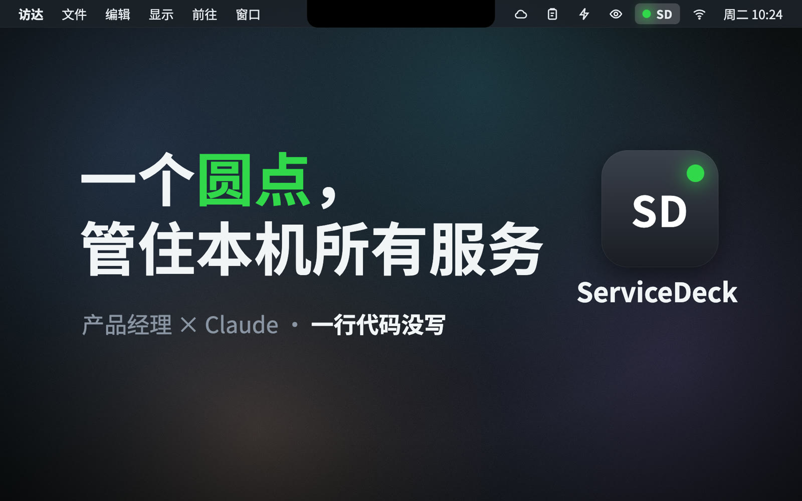
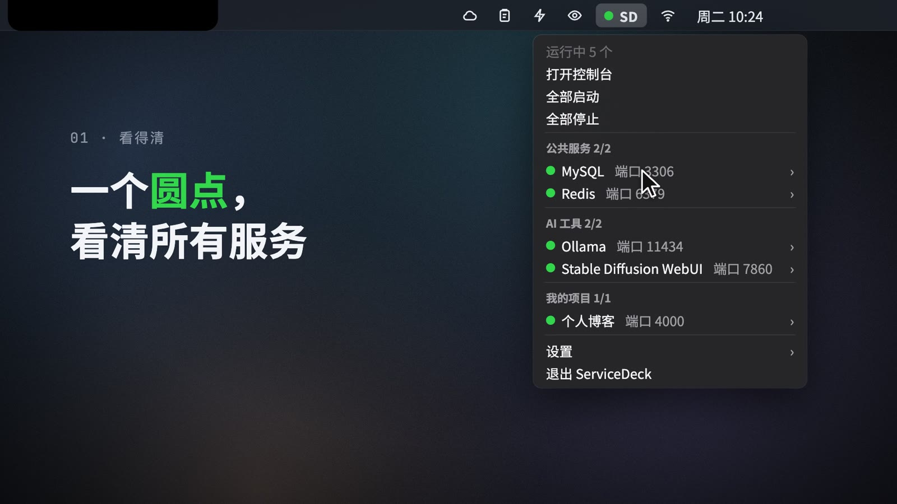
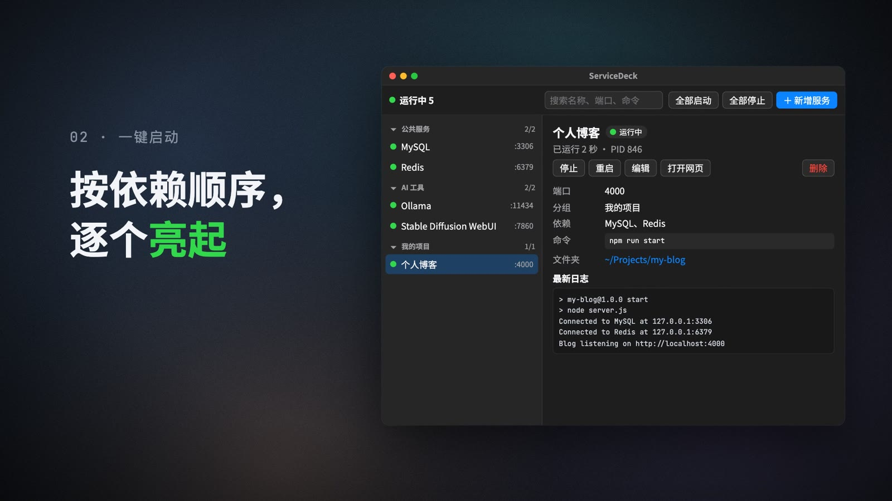
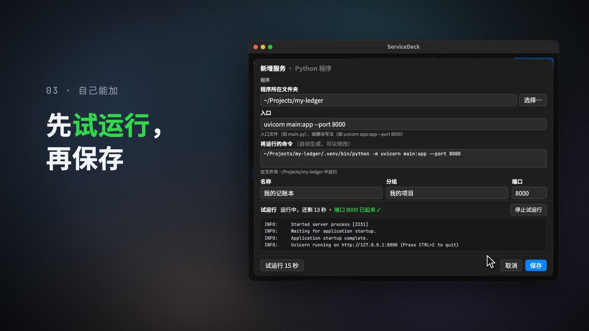
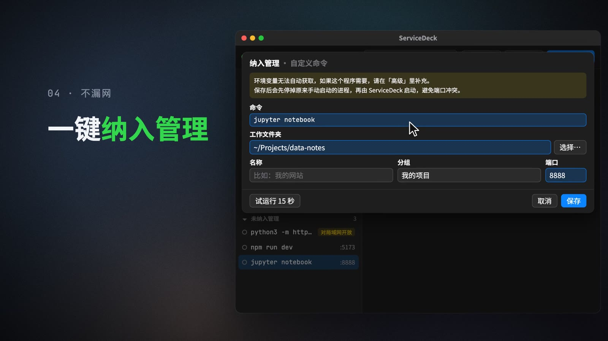

# ServiceDeck

一个常驻 Mac 菜单栏的**本机服务控制台**：用一个圆点看清自己部署的所有服务（数据库、本地大模型、AI 画图、自己的小项目……），点几下就能启停、新增，不用敲命令。

*A menu bar console for the services you run on your own Mac: see everything at a glance with one status dot, start, stop and add services without touching the terminal.*



## 它能做什么

- **一个圆点看整体状态**：菜单栏的「● SD」图标——绿色全部正常，黄色有服务正在启动，红色有服务异常，灰色表示服务管理器没在运行。
- **一键全部启动**：按依赖顺序启动（比如网站会等数据库就绪后再启动），带健康检查和崩溃自动重启。
- **自己就能新增服务**：选程序类型（Python / Node / 可执行文件 / Shell 脚本 / 自定义命令），再选文件夹，运行命令自动生成；可以先「试运行 15 秒」，看日志和端口没问题再保存。
- **不漏网**：在终端里随手跑起来、占用了端口的程序会出现在「未纳入管理」里，一键把它纳入管理（命令、文件夹、端口自动预填）。
- **退出 App，服务照常运行**：真正运行服务的是 [process-compose](https://github.com/F1bonacc1/process-compose)，由 macOS 的 launchd 托管，与 App 没有父子关系；App 只负责查看和操作。

| 菜单栏 | 一键启动 |
|---|---|
|  |  |
| **模板新增 + 试运行** | **发现未纳入管理的服务** |
|  |  |

> 截图来自项目的宣传片，片中的服务和数据是演示用的模拟内容。

## 它是怎么做出来的

作者 [@xLuckww](https://github.com/xLuckww) 是产品经理，不是程序员。ServiceDeck 从设计文档到每天在用花了 1 天：作者负责提需求、做决定和验收，**约 5700 行代码和 240 多项自动测试全部由 [Claude](https://claude.ai) 编写**，作者一行代码都没写。

项目的宣传片（`video/` 目录）同样是 Claude 用代码写成的：画面是按时间轴逐帧计算的网页动画，配乐和音效由代码合成，最后用 Chrome 逐帧截图、ffmpeg 合成视频。

## 运行要求

- macOS（作者在 Apple Silicon 的 Mac 上开发和日常使用，其他环境未经测试）
- [mise](https://mise.jdx.dev)（管理 Python 版本和 process-compose）
- [uv](https://docs.astral.sh/uv/)（管理 Python 依赖）
- process-compose v1.122.0（服务管理器，由 mise 安装）

## 安装

在项目文件夹里依次运行：

```bash
mise install                          # 安装项目要求的 Python 3.12
mise use -g process-compose@1.122.0   # 安装服务管理器
uv sync                               # 安装 Python 依赖
scripts/install_app.sh                # 生成 /Applications/ServiceDeck.app
```

然后在访达的「应用程序」里双击 ServiceDeck，菜单栏会出现「● SD」图标。

- App 是"轻量包装"，直接使用项目文件夹里的代码和虚拟环境：**安装后项目文件夹不能移动或删除**，移动后在新位置重新运行 `scripts/install_app.sh` 即可。
- 改了代码后，⌘Q 退出再打开 App 即生效（退出 App 不会停止服务）。
- 卸载：先退出 App，再运行 `scripts/uninstall_app.sh`（保留服务清单和日志，不停止正在运行的服务）。

## 文件在哪里

| 位置 | 内容 |
|---|---|
| `~/.config/servicedeck/services.yaml` | 服务清单（在窗口里改就行，不用手改） |
| `~/.config/servicedeck/backups/` | 每次保存前的自动备份，窗口「设置」里可以一键恢复 |
| `~/Library/Logs/ServiceDeck/` | 每个服务的日志、App 自己的日志 |

## 命令行（排查问题用，日常不需要）

```bash
uv run servicedeck status     # 查看状态；另有 up（全部启动）、down（全部停止）、validate（检查清单）
```

## 开发

- 运行测试（使用临时目录和 183xx 端口，不会碰到你真实的服务）：`uv run pytest`
- App 行为和界面测试会出现菜单栏图标、弹出窗口，默认跳过：`SERVICEDECK_APP_TESTS=1 uv run pytest tests/app`
- 从源码直接运行 App：`uv run python -m servicedeck.app.main`

代码注释里提到的「设计文档 X 节」「决策 Sx」指作者的内部设计文档，未包含在公开仓库中。

代码结构（`src/servicedeck/`）：`registry.py` 服务清单 · `templates.py` 新增服务模板 · `compose/` 与 process-compose 通信和启停 · `status.py` 状态汇总 · `discovery.py` 发现未纳入管理的服务 · `actions.py` 所有操作的统一入口 · `app/` 菜单栏图标、窗口和界面（pywebview + PyObjC，界面是原生 HTML/CSS/JS）。

## 宣传片源码（`video/`）

```bash
uv run python video/audio.py          # 用代码合成配乐和音效
uv run python video/render.py preview # 用 Chrome 打开可拖动的预览页面
uv run python video/render.py render  # 渲染成片到 video/out/（需要本机安装 Google Chrome 和 ffmpeg）
```

仓库里的字体是按片中文字裁出的子集；改了片中文字需要先把 [Noto Sans SC](https://github.com/google/fonts/tree/main/ofl/notosanssc) 和 [JetBrains Mono](https://github.com/google/fonts/tree/main/ofl/jetbrainsmono) 的可变字体放进 `video/assets/fonts/src/`，再运行 `uv run python video/make_fonts.py`。素材说明见 [video/CREDITS.md](video/CREDITS.md)。

## 已知限制

- 目前只在作者自己的 Mac 上验证过；process-compose "重新加载只重启改动的服务"是 v1.122.0 的实测行为，换版本需重新验证。
- 在终端手动运行、但程序位于某个 `.app` 包内的服务（如 `Ollama.app` 里的 `ollama serve`）不会出现在「未纳入管理」里。
- 服务管理器自身崩溃时不会自动重启，需要在 App 里点「启动全部服务」。

## 许可

[MIT](LICENSE)
